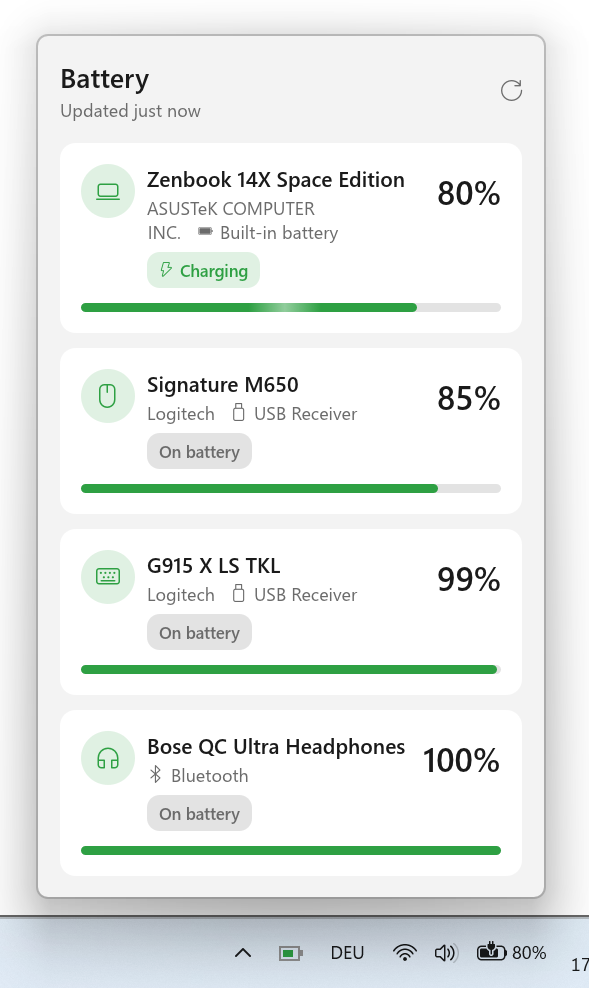

# akkutray

See the battery level of your laptop, mouse and keyboard, and Bluetooth headphones at a glance, from
the command line or from a small tray icon on Windows and Linux.

<p align="center">
  <picture>
    <source media="(prefers-color-scheme: dark)" srcset="docs/images/screenshot-tray-ui-dark.png">
    
  </picture>
</p>

- **No Logitech G Hub needed.** akkutray talks to Logitech receivers directly, and can run next to G Hub.
- **One place for all batteries.** The computer itself, Logitech devices and Bluetooth headphones.
- **Light enough to run all day.** The tray sleeps between updates every 5 minutes.

## Quick start

You need Windows or Linux and the [Rust toolchain](https://rustup.rs/). On Linux, see the [Linux notes](docs/troubleshooting.md#linux) too.

```powershell
cargo install --path .   # build and install
akkutray                 # print battery levels once to the terminal
akkutray tray            # show a tray icon in the background
```

To have the tray icon appear every time you log in, see [Start with Windows](docs/autostart.md).

## Documentation

**Getting started**

- [Installation](docs/installation.md): install, update and uninstall
- [Usage](docs/usage.md): the command line and the tray icon
- [Start with Windows](docs/autostart.md): start the tray at login

**Reference**

- [Supported devices](docs/supported-devices.md): which devices work and which don't
- [Troubleshooting](docs/troubleshooting.md): missing devices, hidden icon, slow readings
- [Power consumption](docs/power-consumption.md): why the tray is fine on a laptop

**Under the hood**

- [How it works](docs/how-it-works.md): where the readings come from and how the code is laid out

## License and disclaimer

> 🟣 This is a personal project, created with the help of AI to save on development time. While simplicity of the implementation has been a focus, there is no guarantee on its stability.

This project is published under the [MIT License](LICENSE).
